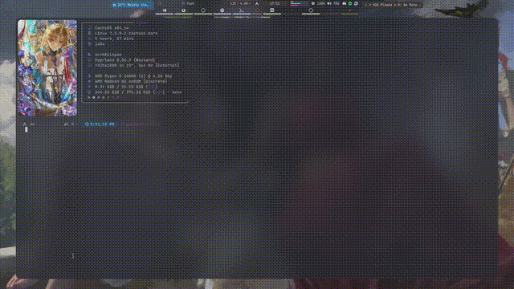

# ColorEclipse

Light/dark theme applier for [ArchEclipse](https://github.com/AymanLyesri/ArchEclipse).
Rust replacement for hypr's former `theme/scripts/*.sh`, shipped as its own
package so the compositor config no longer compiles anything at login.

It drives the system color-scheme (`gsettings`), the GTK/icon/cursor themes, and
internal wallpaper color generation — in parallel, from one binary.

## Why

Six shell scripts (414 lines) each re-read the same flags file and re-spawned
`gsettings`; the appliers had to be launched as four background jobs and their
failures were swallowed. One process with a thread per component does the same
work without the shells, and `wal` (wallpaper → colors) no longer lives inside
the hypr config at all.
